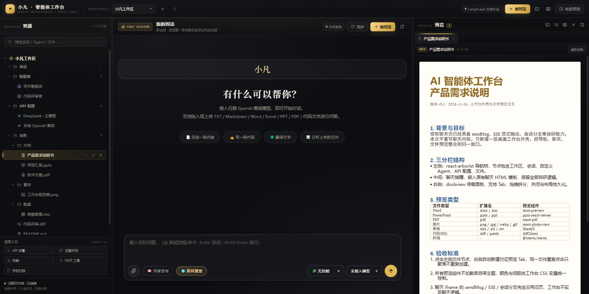
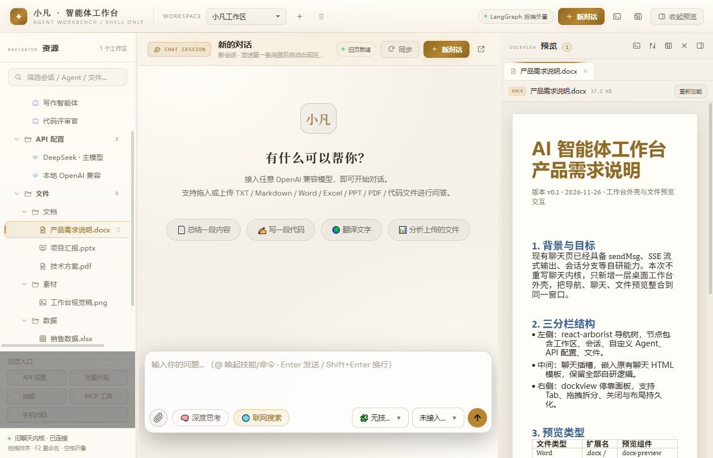
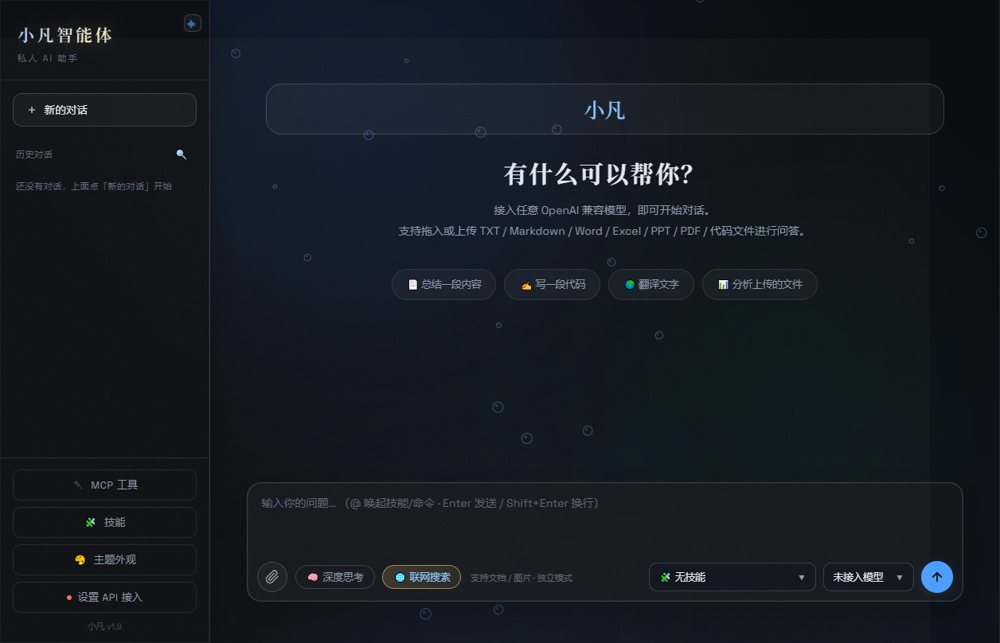

# 小凡 · AI 智能体工作台



一个**全新的独立 Vite 项目**（`workbench/`）。聊天内核仍由旧 `index.html` 提供，工作台只负责三栏桌面外壳、预览和文件树。

> 全程没有引入 assistant-ui，也没有使用它的 runtime、hooks、组件。聊天内核只通过 iframe 插槽嵌入旧 HTML，`sendMsg` / SSE / 会话分支仍由旧页负责。右侧对话大纲只列用户输入，不列模型输出。

## 技术栈

- React 18 + TypeScript + Vite 6
- zustand（选中节点 / 工作区 / 会话列表 / 中间态 / dockview 布局）
- react-resizable-panels（三栏尺寸、折叠）
- react-arborist（左侧树：排序、重命名、文件夹折叠）
- dockview-react（右侧停靠：Tab、拖拽拆分、关闭、布局持久化）
- @dnd-kit/core（把文件节点拖到右侧打开预览）
- 预览：docx-preview、pptx-react-viewer、react-pdf、react-photo-view、SheetJS(xlsx)、diff2html、@xterm/xterm

没有 antd / MUI 等重型 UI 库；左侧树使用裸 DOM + 自定义 `wb-*` className。

## 目录

```
workbench/
├─ src/
│  ├─ App.tsx                    三栏布局 + DnD + Toast
│  ├─ components/
│  │  ├─ TreePanel.tsx           react-arborist 树
│  │  ├─ Center/ChatHost.tsx     旧聊天页 iframe + bridge
│  │  ├─ Center/ConfigHost.tsx   旧 Agent / API HTML 插槽
│  │  ├─ DockHost.tsx            dockview 停靠区
│  │  └─ Previews/               七类预览组件 + 后缀映射
│  ├─ lib/
│  │  ├─ dockController.ts       dockview 对外 API 封装
│  │  ├─ preview.ts              后缀判断 / 文件 → 预览参数
│  │  ├─ chatBridge.ts           iframe postMessage 桥
│  │  └─ expose.ts               window.xiaofanWorkbench
│  ├─ store/workbench.ts         zustand + localStorage 持久化
│  └─ styles/                    全部自定义 CSS
├─ public/
│  ├─ workbench.config.js        旧页路径配置（改完刷新即可）
│  ├─ samples/                   预览示例文件
│  └─ legacy/                    旧页副本（脚本生成，已 gitignore）
└─ scripts/
   ├─ sync-legacy.mjs            只复制、不修改根目录旧 index.html
   └─ make-samples.py            重新生成示例 docx/pptx/pdf/png/xlsx/diff
```

## 启动

要求 Node.js **≥ 22.12**（react-arborist v4 的 engines 约束；Vite 6 / pdfjs 也需要新 Node）。

前端和后端是**两个进程**，都必须起来：`workbench` 只负责界面，`/api`、`/v1` 由 Vite 代理到仓库根目录的 `server.py`（8765）。后端不在时，内嵌的旧聊天页会降级成「独立模式」直连模型，智谱/GLM 会被跨域拦掉（报 Failed to fetch）。

最省事：双击 `start-workbench.bat`（先确认 8765 后端再起 Vite，日志在 `.dev-logs\`）。

手动启动（两个终端）：

```bash
# 终端 1：后端（仓库根目录）
python server.py

# 终端 2：前端
cd workbench
npm run dev
# http://127.0.0.1:5276
```

> 本机没有全局 `pnpm`（README 旧版写的 `pnpm dev` 会报“不是内部或外部命令”）；依赖已经用 pnpm 装好，直接用 `npm run dev` 就能跑。
> Vite 必须显式 `host: "127.0.0.1"`（见 `vite.config.ts`）——默认绑 localhost 在 Windows 上只听 IPv6 `[::1]`，`127.0.0.1:5276` 会 ERR_CONNECTION_REFUSED。

`predev` / `prebuild` 会自动执行 `scripts/sync-legacy.mjs`：

- 从仓库根目录读取旧 `index.html`
- 复制成 `public/legacy/chat.html`（**原文件只读，绝不修改**）
- 副本里只做几件嵌入适配：
  - 隐藏旧侧栏 / 旧右侧预览 / 背景装饰
  - 强制深色基础皮肤、隐藏旧首次引导弹窗
  - 把 `./api/health` 改成同源 `/api/health`
  - 在最后 `</body>` 前追加 bridge（会话列表、选中会话、重命名、排序）
- 复制旧页依赖的 marked / mermaid / echarts / purify / qrcode 等资源
- 不复制 `config.local.js`（私有 Key），也不复制 service worker

根目录没有 `index.html` 时脚本会跳过，工作台显示“未找到旧聊天页”。

生产构建：

```bash
pnpm build
```

## 旧页面接入（不生成任何表单）

### 聊天页

默认路径：`public/legacy/chat.html`。

工作台只负责中间 iframe 插槽，聊天逻辑完全在旧页。首次进入时会通过 `postMessage` 同步：

- 旧页 → 工作台：`{ __wb: 1, source: 'chat', type: 'state', sessions, activeId }`
- 工作台 → 旧页：`ping / refresh / openSession / newSession / renameSession / reorderSessions`

如果要把聊天页换成另一个模板，改 `public/workbench.config.js` 的 `chat` 即可。

### Agent / API 配置页

把你自己的旧 HTML 放到：

```
public/legacy/agent-config.html
public/legacy/api-config.html
```

点击左侧对应节点时，中间栏直接加载该页面。**工作台不会自动新建、生成 Agent 表单、换肤面板或模型配置页面**；页面里的表单、Key 输入、保存逻辑完全由旧页决定。

路径可以不改代码，直接改 `public/workbench.config.js`：

```js
window.__WORKBENCH_CONFIG__ = {
  chat: "/legacy/chat.html",
  agent: "/legacy/agent-config.html",
  api: "/legacy/api-config.html",
  terminalWs: "", // 可选：ws://... 真实 PTY
};
```

探测旧页时会识别工作台自己的 Vite fallback，避免 iframe 套娃；找不到时显示“重新检测 / 在新窗口打开”的空状态。

## 左侧工作区是什么

工作区只是一个**树形容器**，用来隔离不同项目的会话入口、自定义 Agent、API 配置节点和文件树。默认只有 `小凡工作区`，里面的内容分四组：

| 分组 | 内容 | 来源 |
|---|---|---|
| 会话 | 聊天会话 | 从中间旧聊天页同步（不是工作台自己存的聊天记录） |
| 智能体 | 自定义 Agent 节点 | 示例节点；点击后加载你的旧 Agent HTML |
| API 配置 | API 节点 | 示例节点；点击后加载你的旧 API HTML |
| 文件 | 文件 / 文件夹 | 默认 `public/samples/` 示例文件；真实工作区可换成后端文件树 |

默认工作区带演示用的示例 Agent、API 节点和 `samples/` 文件；**新建的工作区从空分组开始**，不会复制演示文件。会话始终归旧聊天页所有，删除工作区不会删除聊天记录，只会在本地重新分配到其他工作区。

### 删除

- 左侧工作区行悬停出现垃圾桶，或顶栏工作区选择器旁的垃圾桶：删除当前工作区。
- 删除前会弹确认框；**至少保留一个工作区**，只剩一个时按钮禁用。
- 工作区里的会话会转移到剩余工作区；聊天记录不删除。
- 文件 / 文件夹 / 智能体 / API 节点的垃圾桶是**只从工作台树中移除**，不会删磁盘文件，也不会删除旧 HTML 页面。
- 会话的垃圾桶会同时调用旧聊天页的删除逻辑，聊天内容不可恢复。

## 旧页入口（主题 / API / 技能 / MCP）

左侧树底部新增「旧页入口」：

- **API 设置**：打开旧聊天页自带的接入设置弹窗。
- **主题外观**：打开旧聊天页自带的主题面板。
- **技能**：打开旧页技能列表。
- **MCP 工具**：打开旧页 MCP 管理。
- **手机扫码**：打开旧页扫码弹窗。

这些入口都通过 `postMessage` 调旧页原来的函数，不在工作台里重写表单。API 配置节点找不到旧 HTML 时，也会提供「打开旧页 API 设置」按钮。

### 主题同步（整屏换肤）

旧页的主题面板会同时驱动工作台外壳，而不是只换中间聊天区：

- 旧页每次切换主题，都会向父窗口发 `{ __wb: 1, source: 'chat', type: 'theme', theme }`。
- 工作台收到后写入 `<html data-wb-theme="...">` 并存到 `localStorage`（键 `xiaofan-workbench-theme`），刷新后保持。
- `workbench.css` 为旧页的 10 套主题分别定义了 `--wb-*` 变量：鎏金墨黑（默认）、深海蓝、赛博紫、翡翠绿、暖橘夜、玫红夜，以及浅色系的奶油暖白、雾蓝浅色、极简浅灰、薄荷浅绿。
- 左树、顶栏、聊天插槽、dockview 标签/面板、七种预览的工具栏与画布底色、确认弹窗、滚动条全部用这些变量，所以跟着一起换。
- 左侧「快捷入口」也使用同一套主题变量，不再是一块固定深色底板。
- 浅色主题有单独的细节覆盖层（选中行、搜索框、弹窗遮罩、纸张阴影、diff 增删文字颜色），保证对比度。
- 终端预览保持深色底（xterm 自带 theme），不随浅色主题变白，避免命令行不可读。



### 壁纸 / 照片 / 主题动效

旧页里的「官方壁纸库」「我的照片」「自定义背景图」「照片漂浮」在工作台里同样可用：

- `sync-legacy.mjs` 会把根目录 `wallpapers/` 同步到 `public/wallpapers/`，并把副本里的 `./wallpapers/` 改成 `/wallpapers/`，壁纸缩略图不再 404。
- 旧页仍然负责中间聊天区的壁纸和裁剪后的照片；工作台外壳读取同一个 `aria.bgImage`，用 `WorkbenchBackdrop` 把同一张图铺到左树、顶栏和右侧停靠区。
- 主题动效由 `src/lib/backdropEffects.ts` 移植旧页的 `#meteors` 引擎，外壳和中间聊天区都能看到。
- 浅色主题下，壁纸上的暗化层会换成浅色薄雾，避免深色文字压在暗背景上看不清。
- 右侧预览默认收起，点顶栏「展开预览」再展开。

### 直接打开旧聊天页

`/legacy/chat.html` 被同源 iframe 嵌入时，脚本自动加 `html.wb-embed` 隐藏旧侧栏；**直接在浏览器打开时不会加这个 class**，旧侧栏、历史对话、MCP / 技能 / 主题入口、版本号全部保留，等同于原来的单页。



## 右侧 dockview API

外部脚本、旧页、后端生成的页面都可以调用：

```js
// 按文件路径打开（自动按后缀匹配预览）
window.xiaofanWorkbench.openFile({
  path: "samples/design.png",
  name: "工作台视觉稿.png",
  url: "/samples/design.png",
});

// 打开完整预览参数（适合后端返回 kind/title/file）
window.xiaofanWorkbench.openPreview({
  kind: "diff",
  title: "registry.ts",
  diff: { fileName: "registry.ts", oldText, newText },
});

window.xiaofanWorkbench.openTerminal({ cwd: "~/xiaofan" });
window.xiaofanWorkbench.openDiff({ fileName: "a.ts", oldText, newText });

window.xiaofanWorkbench.closeTab(panelId);
window.xiaofanWorkbench.closeAll();
window.xiaofanWorkbench.resetLayout();
window.xiaofanWorkbench.getLayout();
window.xiaofanWorkbench.restoreLayout(layout);
window.xiaofanWorkbench.selectNode("sess:xxx");
```

旧页也可以在**同源** iframe 里 `postMessage`：

```js
parent.postMessage({ __wb: 1, type: "open-file", file: { path, name, url } }, location.origin);
parent.postMessage({ __wb: 1, type: "open-terminal", cwd: "~" }, location.origin);
parent.postMessage({ __wb: 1, type: "open-diff", diff: { fileName, oldText, newText } }, location.origin);
parent.postMessage({ __wb: 1, type: "select-node", id: "file:..." }, location.origin);
parent.postMessage({ __wb: 1, type: "notify", message: "..." }, location.origin);
```

默认浏览器标签去重键是文件 `path`；同一文件重复点击只聚焦，不重复创建。

## 后缀映射

`src/lib/preview.ts` 的 `resolvePreviewKind(path)`：

| 后缀 | 预览 |
|---|---|
| `.docx` / `.doc` | docx-preview |
| `.pptx` / `.ppt` | pptx-react-viewer（懒加载，只读、无工具栏） |
| `.pdf` | react-pdf |
| `.png` / `.jpg` / `.jpeg` / `.webp` / `.gif` / `.bmp` / `.svg` / `.avif` | react-photo-view |
| `.xlsx` / `.xls` / `.csv` / `.tsv` | SheetJS |
| `.diff` / `.patch` | diff2html（并排 / 统一视图） |
| `.txt` / `.md` / 代码/配置文件 | 文本预览 |
| 其他 | 不支持提示 |

## 样式

- 所有视觉 token 在 `src/styles/workbench.css` 顶部（`--wb-*`），深色为默认，浅色主题用 `html[data-wb-theme^="light"]` 覆盖层补充。
- 主题随旧页切换：`<html data-wb-theme>` + `localStorage['xiaofan-workbench-theme']`，预览面板、dockview、左树、弹窗同步换色。
- dockview 只加载其结构 CSS，使用自定义 `wb-dv-theme`，不启用任何 `dockview-theme-*` 内置主题。
- xterm 使用自定义 theme，并在外部覆盖 viewport / 背景。
- diff2html 不加载自带 CSS，`d2h-*` 结构样式由 `previews.css` 接管。
- react-photo-view 只导入结构 CSS，遮罩/工具栏/箭头全部覆盖。
- pptx-react-viewer 传自定义 `ViewerTheme`，并隐藏 titleBar / ribbon / slidesPane / inspector 等全部 chrome。

## 已知边界

- 工作台是**外壳**：LLM、工具调用、智能体编排仍归后端 LangGraph；这里没有实现聊天逻辑。
- 终端默认是本地演示命令；真实 PTY 通过 `terminalWs` / `openTerminal({ wsUrl })` 接入，协议是原始字符串双向 WebSocket。
- 预览文件需要可访问的 URL；示例文件来自 `public/samples/`。接入真实工作区时，把树节点的 `url` 指向后端文件接口（同源）。
- 旧 Agent / API 页面没有提供时只显示空状态，不生成替代表单。
- 跨域 iframe 无法共享同源 bridge；聊天/配置页建议同源部署。
- dockview 布局存在 localStorage（`xiaofan-workbench-v1`），刷新恢复；调试时可用右侧“重置布局”。
- `pptx-react-viewer` 包体较大，已通过 `React.lazy` 延迟到第一次打开 PPTX 时加载。
